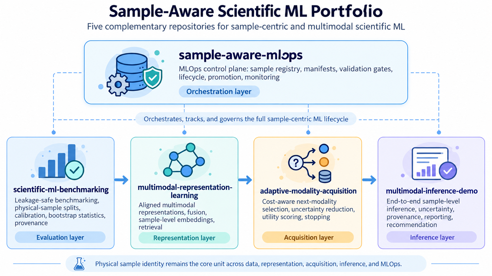
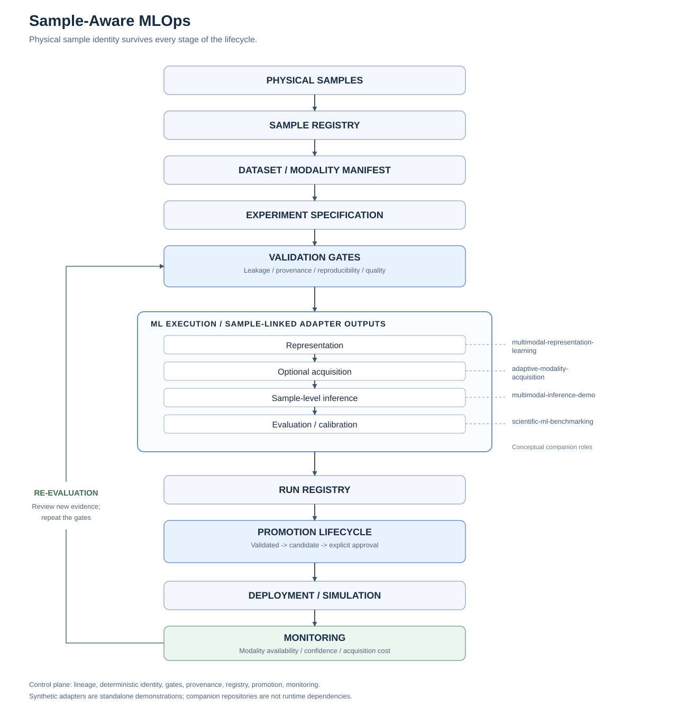

# Sample-Aware MLOps

[](https://github.com/vagelisNerantzis/sample-aware-mlops/actions/workflows/tests.yml)

**An MLOps framework for reproducible, leakage-safe scientific machine learning that preserves physical-sample identity across data lineage, validation, inference, promotion, and monitoring.**

The physical sample is the fundamental unit of the ML lifecycle. Sample-Aware MLOps carries that identity through observation registration, experiment execution,
evaluation, promotion, and monitoring. Version **0.1.0** provides an executable,
standalone control plane with deterministic synthetic adapters.
<p align="center">
  
</p>
## Why sample identity matters

Rows, files, model versions, and prediction requests are useful MLOps
abstractions, but a scientific sample can produce many images, spectra, crops,
and repeated measurements. Splitting these observations independently can
place the same physical sample on both sides of an evaluation boundary.
Losing lineage also makes it difficult to identify which samples contributed
to a metric, an artifact, or a monitoring alert.

This framework makes physical sample membership explicit, binds run identity
to immutable input manifests, and blocks lifecycle promotion when required
evidence is missing or inconsistent. It implements these checks and lifecycle
transitions directly; the companion projects provide the conceptual ML layers.

## Architecture



Physical samples -> sample registry -> dataset manifest -> experiment specification
-> validation gates -> representation / acquisition / inference / evaluation
-> run registry -> promotion -> simulated deployment -> monitoring -> re-evaluation.

The [architecture document](docs/architecture.md) explains the record boundaries
and [figure generator](assets/generate_architecture.py) reproduces the SVG
without external rendering dependencies.

## Executable lifecycle

```text
REGISTERED -> VALIDATED -> CANDIDATE -> APPROVED -> DEPLOYED -> MONITORED
```

`run_pipeline(...)` validates the run, executes synthetic stage adapters, records
sample-level evidence, and returns a `CANDIDATE` or `REJECTED` record. Explicit
approval and deployment metadata are required for the remaining transitions.
Deployment records a simulation; it does not start a service or provision
infrastructure. Pre-deployment runs can be rejected with a reason, and a rejected
run cannot be promoted.

Promotion rechecks current evidence. Required gate results bind to the run's full
fingerprint; a known leakage failure cannot be replaced with a pass. Metrics
become immutable at `CANDIDATE`, and earlier metric changes invalidate stale
quality and result-reproducibility evidence. Each run retains immutable manifest
and specification snapshots and checks that identity, split membership, and
promotion policy agree with their hashed inputs. See the
[exact transition rules](docs/mlops_lifecycle.md).

## Validation gates

| Gate | Evidence checked | Blocking condition |
| --- | --- | --- |
| `LeakageGate` | Physical sample membership in train / validation / test | A sample appears in incompatible splits. |
| `ProvenanceGate` | Required identity fields and their consistency with the run | Required provenance is missing or inconsistent. |
| `ReproducibilityGate` | Input identity; actual output fingerprint replay in strict mode | Required identity or deterministic result evidence differs. |
| `QualityGate` | Supplied metrics and configured thresholds | A required metric is missing or violates its threshold. |

A failed `ERROR` gate blocks the aggregated result. A failed `WARNING` remains a
diagnostic. Lifecycle-required gates must actually pass; warning severity does
not turn a failed required gate into promotion evidence. Quality thresholds are
inclusive: accuracy must be at least the minimum, and ECE / failure rate must be
at most their maxima. The synthetic pipeline evaluates validation samples by
default and does not use held-out test metrics for promotion. The pipeline also
records `EvaluationPolicyGate`, which blocks non-validation cohorts before ML
stages execute.

## Monitoring

Monitoring inputs retain physical sample IDs, including IDs for the reference
cohort. The run registry accepts monitoring evidence only for physical IDs in
that run's manifest. Unseen samples need explicit lineage registration in a new
manifest and run; live production-data ingestion is outside v0.1.0. Implemented
signals are deliberately explicit:

- **Missing modality rate:** missing expected sample-by-modality slots divided by
  all expected slots.
- **Confidence drift:** absolute difference between current and reference mean
  confidence.
- **Cost drift:** absolute difference between mean acquisition costs, optionally
  divided by reference mean cost.

`ThresholdDriftRule` triggers only when a value is strictly greater than its
threshold. Alerts request review or re-evaluation; they do not automatically
retrain or roll back a model. These are descriptive threshold rules, not
statistical significance tests.

## Installation and demo

Python **3.10 or newer** is required. The runtime uses only the standard library;
`pytest` is the development dependency.

```console
python -m pip install -e ".[dev]"
python examples/run_sample_aware_mlops.py
```

The demo creates synthetic physical samples and modality observations, builds
an immutable manifest and experiment identity, executes the gated pipeline,
approves and simulates deployment, records monitoring signals, and reaches
`MONITORED`. It also demonstrates blocked operations, including intentional
physical sample leakage, without failing the successful demo. The toy acquisition
adapter selects the cheapest single feasible modality within budget; it is not
a full adaptive acquisition engine.

Schematic output below shows the report's content, not measured model results:

```text
Run: run-<deterministic fingerprint prefix>
Dataset hash: <SHA-256>
Config hash: <SHA-256>
Gates: LeakageGate / ProvenanceGate / ReproducibilityGate / QualityGate
Metrics: accuracy, ece, failure_rate
Lifecycle: REGISTERED -> VALIDATED -> CANDIDATE -> APPROVED -> DEPLOYED -> MONITORED
Monitoring: missing_modality_rate, confidence_drift, cost_drift
Final status: MONITORED
Intentional leakage: blocked
```

## Portfolio integration

| Companion repository | Conceptual stage |
| --- | --- |
| [multimodal-representation-learning](https://github.com/vagelisNerantzis/multimodal-representation-learning) | Modality-specific representations and fusion |
| [adaptive-modality-acquisition](https://github.com/vagelisNerantzis/adaptive-modality-acquisition) | Cost-aware measurement selection and stopping |
| [multimodal-inference-demo](https://github.com/vagelisNerantzis/multimodal-inference-demo) | Sample-level inference, uncertainty, and reporting |
| [scientific-ml-benchmarking](https://github.com/vagelisNerantzis/scientific-ml-benchmarking) | Leakage-safe evaluation, calibration, and benchmarking |

These are architectural relationships, not runtime dependencies. Internal
callable adapters keep this repository independently installable. No companion
repository is imported or copied. See the
[integration contracts](docs/portfolio_integration.md).

## Reproducibility

Canonical JSON and SHA-256 identify manifests and experiment specifications.
Manifest ordering does not affect identity; changing a physical sample's split,
configuration, seed, or supplied code revision changes the relevant identity.
A readable `run-...` prefix is retained alongside the full fingerprint.

Strict mode executes the actual synthetic adapters again and compares recorded
output fingerprints. Event indices replace wall-clock timestamps in registry
history. Environment provenance contains only explicitly permitted summary
fields, and artifact records store content hashes and sample coverage rather
than binary payloads. These checks establish deterministic synthetic execution;
they do not claim bitwise reproducibility for external ML models or authenticate
a supplied code revision. Handled stage or governance errors are recorded as a
blocking `ExecutionGate` with the exception type only, avoiding potentially
private exception messages in run provenance.

The [example YAML](configs/experiment.example.yaml) documents configuration
intent. Runtime configuration is typed Python data; YAML parsing is not required.

## Validation

```console
python -m compileall src tests examples assets
pytest -q
python examples/run_sample_aware_mlops.py
python assets/generate_architecture.py --check
python -c "import sample_aware_mlops; print(sample_aware_mlops.__version__)"
```

Tests cover sample / observation uniqueness, deterministic hashing, provenance,
required gates, immutable evidence, lifecycle transitions, monitoring, and
orchestration. The [validation report](docs/validation_report.md) records the
actual executed checks and counts.

[GitHub Actions](.github/workflows/tests.yml) runs on pushes to `main` and pull
requests targeting `main`, using Ubuntu and Python 3.12. It installs the package,
compiles Python files, runs tests and the synthetic demo, regenerates the SVG,
and checks both package versions. No dataset, GPU, secret, or network connection
after dependency installation is required. A workflow definition and local
checks do not establish that GitHub-hosted CI has passed.

## Repository structure

```text
src/sample_aware_mlops/
  samples/          Physical samples, observations, immutable manifests
  experiments/      Typed experiment specifications and run identity
  gates/            Leakage, provenance, reproducibility, quality
  orchestration/    Deterministic pipeline and synthetic stages
  registry/         Run records, events, artifact metadata
  lifecycle/        Explicit states and promotion rules
  monitoring/       Sample-aware signals and threshold rules
  provenance/       Canonical serialization, hashes, safe environment summary
  adapters/         Stage interfaces
  reporting/        Human-readable run summaries
  validation/       Shared input validation
examples/           Complete synthetic lifecycle
configs/            Illustrative experiment configuration
tests/              Deterministic unit and integration tests
docs/               Architecture, lifecycle, integration, validation
assets/             Reproducible SVG and its generator
.github/workflows/  Synthetic CI validation
```

## Scope, limitations, and roadmap

Version 0.1.0 is a synchronous, in-memory research framework. Synthetic adapters
demonstrate orchestration and do not establish scientific model performance.
Registry state is not a persistent audit log, artifact hashes do not store model
files, and approval metadata is not authentication. Callers must sanitize their
own free-form metadata and use identifiers safe for public provenance. Monitoring
rules are descriptive; no automatic production deployment, retraining, or rollback
is implemented.

Future work may add a persistent registry backend, richer drift statistics,
external portfolio adapters, model registry integration, CI/CD policy enforcement,
and AgentOps policy agents. Those integrations are not part of this release.

Released under the [MIT license](LICENSE).
